# Lab8Web - Praktikum 8: PHP dan Database MySQL (CRUD)

| | |
|---|---|
| **Nama** | Nurfaiz Pradibto Nugroho |
| **NIM** | 312510172 |
| **Kelas** | I253C |
| **Program Studi** | Teknik Informatika |
| **Mata Kuliah** | Pemrograman Web OBE |

## Daftar Isi
1. [Tujuan Praktikum](#1-tujuan-praktikum)
2. [Dasar Teori Singkat](#2-dasar-teori-singkat)
3. [Alat dan Bahan](#3-alat-dan-bahan)
4. [Langkah-Langkah Praktikum](#4-langkah-langkah-praktikum)
5. [Perbaikan terhadap Kode Modul](#5-perbaikan-terhadap-kode-modul)
6. [Menjalankan Program](#6-menjalankan-program)
7. [Kesimpulan](#7-kesimpulan)

---

## 1. Tujuan Praktikum
1. Memahami konsep dasar database.
2. Memahami konsep dasar CRUD (Create, Read, Update, Delete) menggunakan PHP.
3. Membuat program CRUD sederhana menggunakan PHP dan MySQL.

## 2. Dasar Teori Singkat
- **Database** adalah kumpulan data terstruktur yang disimpan dan dikelola oleh DBMS (Database Management System). Pada praktikum ini digunakan MySQL/MariaDB yang dijalankan melalui XAMPP.
- **CRUD** adalah empat operasi dasar pada data: **Create** (INSERT, menambah data), **Read** (SELECT, menampilkan data), **Update** (UPDATE, mengubah data), dan **Delete** (DELETE, menghapus data).
- **mysqli** adalah ekstensi PHP untuk berkomunikasi dengan MySQL, misalnya `mysqli_connect()` untuk koneksi dan `mysqli_query()` untuk menjalankan perintah SQL.

## 3. Alat dan Bahan
- XAMPP (Apache dan MySQL/MariaDB)
- Text editor (VSCode)
- Browser (Chrome/Firefox)
- Git dan akun GitHub

## 4. Langkah-Langkah Praktikum

### 4.1 Persiapan: Menjalankan Apache dan MySQL
1. Buka **XAMPP Control Panel**.
2. Klik **Start** pada modul **Apache** dan **MySQL** sampai statusnya berwarna hijau (Apache port 80, 443; MySQL port 3306).

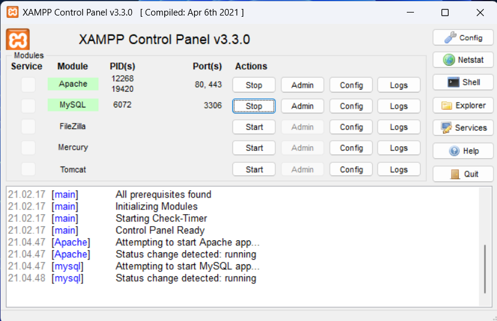

*Gambar 1. Apache dan MySQL sudah berjalan di XAMPP Control Panel*

### 4.2 Mengakses phpMyAdmin
Buka browser dan akses `http://localhost/phpmyadmin/`. Halaman ini adalah MySQL client berbasis web untuk mengelola database.

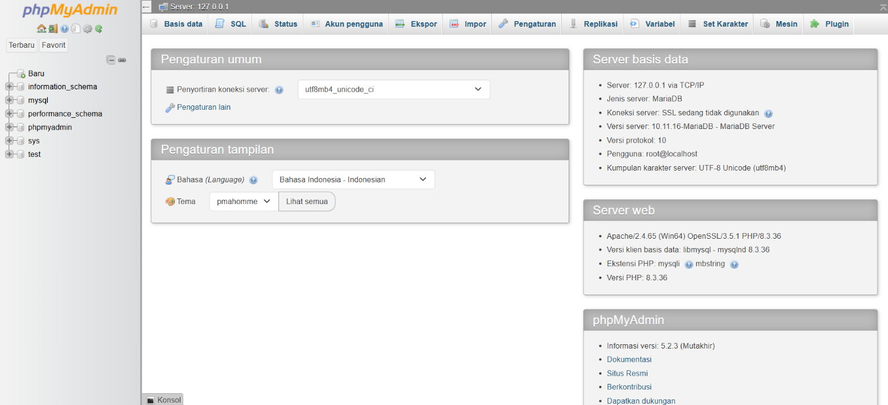

*Gambar 2. Tampilan awal phpMyAdmin*

### 4.3 Membuat Database
Pada tab **SQL** di phpMyAdmin, jalankan perintah berikut untuk membuat database bernama `latihan1`:

```sql
CREATE DATABASE latihan1;
```

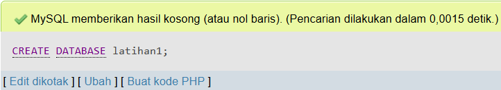

*Gambar 3. Database latihan1 berhasil dibuat*

> **Catatan:** jika muncul error `#1007 - Can't create database 'latihan1'; database exists`, berarti database sudah ada. Gunakan database tersebut, atau hapus dulu dengan `DROP DATABASE latihan1;` lalu buat ulang.

### 4.4 Membuat Tabel `data_barang`
Rancangan tabel studi kasus data barang:

| Nama Field | Tipe Data | Ukuran | Keterangan |
|---|---|---|---|
| id_barang | INT | 10 | Primary Key, Auto Increment |
| kategori | VARCHAR | 30 | Kategori barang |
| nama | VARCHAR | 50 | Nama barang |
| gambar | VARCHAR | 100 | Nama file gambar |
| harga_beli | DECIMAL/INT | 10 | Harga beli |
| harga_jual | DECIMAL/INT | 10 | Harga jual |
| stok | INT | 4 | Jumlah stok |

Pilih database `latihan1`, buka tab **SQL**, lalu jalankan:

```sql
CREATE TABLE data_barang (
  id_barang int(10) auto_increment Primary Key,
  kategori varchar(30),
  nama varchar(50),
  gambar varchar(100),
  harga_beli decimal(10,0),
  harga_jual decimal(10,0),
  stok int(4)
);
```

> **Catatan:** pada modul, kolom `nama` tertulis `varchar(30)` di SQL tetapi 50 di tabel rancangan. Di laporan ini dipakai `varchar(50)` agar nama barang yang panjang tetap muat.

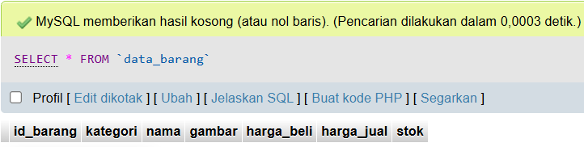

*Gambar 4. Tabel data_barang berhasil dibuat (masih kosong)*

### 4.5 Menambahkan Data Awal (INSERT)
Jalankan perintah `INSERT` berikut untuk mengisi tiga data contoh:

```sql
INSERT INTO data_barang (kategori, nama, gambar, harga_beli, harga_jual, stok)
VALUES ('Elektronik', 'HP Samsung Android', 'hp_samsung.jpg', 2000000, 2400000, 5),
('Elektronik', 'HP Xiaomi Android', 'hp_xiaomi.jpg', 1000000, 1400000, 5),
('Elektronik', 'HP OPPO Android', 'hp_oppo.jpg', 1800000, 2300000, 5);
```

Cek hasilnya dengan perintah `SELECT * FROM data_barang;` atau lewat tab **Browse**.

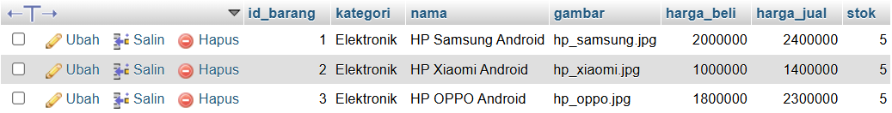

*Gambar 5. Tiga data awal tampil pada tabel data_barang*

### 4.6 Menyiapkan Folder Project
1. Buat folder `lab8_php_database` di `C:\xampp\htdocs` (atau `D:\xampp\htdocs` sesuai instalasi).
2. Di dalamnya buat subfolder `gambar` untuk menyimpan foto barang (`hp_samsung.jpg`, `hp_xiaomi.jpg`, `hp_oppo.jpg`).
3. Buka folder tersebut di VSCode, lalu akses `http://localhost/lab8_php_database/`.

Struktur akhir project:

```
lab8_php_database/
├── gambar/
├── database.sql
├── koneksi.php
├── index.php
├── tambah.php
├── ubah.php
├── hapus.php
└── style.css
```

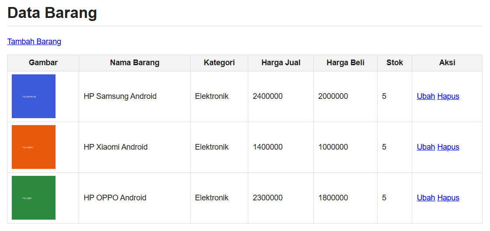

*Gambar 6. Aplikasi dapat diakses di http://localhost/lab8_php_database/*

### 4.7 Membuat File Koneksi Database (`koneksi.php`)
File ini menyimpan konfigurasi koneksi dan dipanggil oleh semua file lain dengan `include`.

```php
<?php
$host = "localhost";
$user = "root";
$pass = "";
$db   = "latihan1";

$conn = mysqli_connect($host, $user, $pass, $db);
if ($conn == false)
{
    echo "Koneksi ke server gagal.";
    die();
} #else echo "Koneksi berhasil";
?>
```

**Penjelasan:** `$host`, `$user`, `$pass`, `$db` berisi alamat server, username, password (kosong untuk XAMPP default), dan nama database. `mysqli_connect()` membuat koneksi; jika gagal (`$conn == false`) program menampilkan pesan lalu berhenti dengan `die()`. Untuk menguji, hilangkan tanda `#` pada bagian `#else echo "Koneksi berhasil";` lalu buka `koneksi.php` di browser. Setelah berhasil, beri tanda `#` kembali.

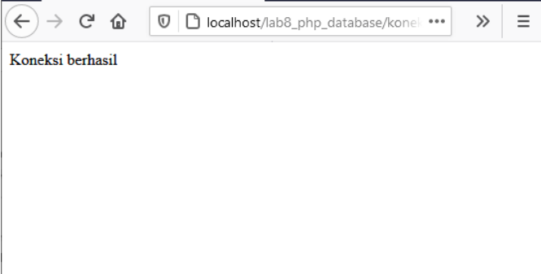

*Gambar 7. Pesan "Koneksi berhasil" pada pengujian koneksi.php*

### 4.8 Menampilkan Data (Read): `index.php`

```php
<?php
include("koneksi.php");

// query untuk menampilkan data
$sql = 'SELECT * FROM data_barang';
$result = mysqli_query($conn, $sql);

?>
<!DOCTYPE html>
<html lang="en">
<head>
    <meta charset="UTF-8">
    <link href="style.css" rel="stylesheet" type="text/css" />
    <title>Data Barang</title>
</head>
<body>
    <div class="container">
        <h1>Data Barang</h1>
        <div class="main">
            <p><a href="tambah.php">Tambah Barang</a></p>
            <table>
            <tr>
                <th>Gambar</th>
                <th>Nama Barang</th>
                <th>Kategori</th>
                <th>Harga Jual</th>
                <th>Harga Beli</th>
                <th>Stok</th>
                <th>Aksi</th>
            </tr>
            <?php if($result && mysqli_num_rows($result) > 0): ?>
            <?php while($row = mysqli_fetch_array($result)): ?>
            <tr>
                <td>" alt="<?= htmlspecialchars($row['nama']);?>"></td>
                <td><?= htmlspecialchars($row['nama']);?></td>
                <td><?= htmlspecialchars($row['kategori']);?></td>
                <td><?= $row['harga_jual'];?></td>
                <td><?= $row['harga_beli'];?></td>
                <td><?= $row['stok'];?></td>
                <td>
                    <a href="ubah.php?id=<?= $row['id_barang'];?>">Ubah</a>
                    <a href="hapus.php?id=<?= $row['id_barang'];?>" onclick="return confirm('Hapus data ini?');">Hapus</a>
                </td>
            </tr>
            <?php endwhile; else: ?>
            <tr>
                <td colspan="7">Belum ada data</td>
            </tr>
            <?php endif; ?>
            </table>
        </div>
    </div>
</body>
</html>
```

**Penjelasan:** `include("koneksi.php")` memuat koneksi. Query `SELECT * FROM data_barang` dijalankan dengan `mysqli_query()`. Hasilnya diulang dengan `while` + `mysqli_fetch_array()` sehingga setiap baris menjadi satu baris tabel HTML. Sintaks `<?= ... ?>` adalah singkatan dari `echo`. Jika tidak ada data, ditampilkan "Belum ada data". Kolom Aksi berisi link **Ubah** dan **Hapus** yang membawa `id_barang` lewat URL (`?id=...`), serta link **Tambah Barang** di atas tabel.


*Gambar 8. Halaman index menampilkan data barang dari database*

### 4.9 Menambah Data (Create): `tambah.php`

```php
<?php
error_reporting(E_ALL);
include_once 'koneksi.php';

if (isset($_POST['submit']))
{
    $nama       = $_POST['nama'];
    $kategori   = $_POST['kategori'];
    $harga_jual = (int) $_POST['harga_jual'];
    $harga_beli = (int) $_POST['harga_beli'];
    $stok       = (int) $_POST['stok'];
    $file_gambar = $_FILES['file_gambar'];
    $gambar = null;

    if ($file_gambar['error'] == 0)
    {
        $filename = str_replace(' ', '_', basename($file_gambar['name']));
        $destination = dirname(__FILE__) . '/gambar/' . $filename;
        if (move_uploaded_file($file_gambar['tmp_name'], $destination))
        {
            $gambar = $filename;
        }
    }

    // prepared statement agar aman dari SQL Injection
    $stmt = mysqli_prepare($conn,
        'INSERT INTO data_barang (nama, kategori, harga_jual, harga_beli, stok, gambar) VALUES (?, ?, ?, ?, ?, ?)');
    mysqli_stmt_bind_param($stmt, 'ssiiis', $nama, $kategori, $harga_jual, $harga_beli, $stok, $gambar);
    mysqli_stmt_execute($stmt);
    header('location: index.php');
    exit;
}
?>
<!DOCTYPE html>
<html lang="en">
<head>
    <meta charset="UTF-8">
    <link href="style.css" rel="stylesheet" type="text/css" />
    <title>Tambah Barang</title>
</head>
<body>
<div class="container">
    <h1>Tambah Barang</h1>
    <div class="main">
        <form method="post" action="tambah.php" enctype="multipart/form-data">
            <div class="input">
                <label>Nama Barang</label>
                <input type="text" name="nama" />
            </div>
            <div class="input">
                <label>Kategori</label>
                <select name="kategori">
                    <option value="Komputer">Komputer</option>
                    <option value="Elektronik">Elektronik</option>
                    <option value="Hand Phone">Hand Phone</option>
                </select>
            </div>
            <div class="input">
                <label>Harga Jual</label>
                <input type="text" name="harga_jual" />
            </div>
            <div class="input">
                <label>Harga Beli</label>
                <input type="text" name="harga_beli" />
            </div>
            <div class="input">
                <label>Stok</label>
                <input type="text" name="stok" />
            </div>
            <div class="input">
                <label>File Gambar</label>
                <input type="file" name="file_gambar" />
            </div>
            <div class="submit">
                <input type="submit" name="submit" value="Simpan" />
            </div>
        </form>
    </div>
</div>
</body>
</html>
```

**Penjelasan:** Form memakai `method="post"` dan `enctype="multipart/form-data"` karena ada upload file. Saat tombol **Simpan** ditekan (`isset($_POST["submit"])`), data diambil dari `$_POST` dan file dari `$_FILES`. File gambar dipindahkan ke folder `gambar/` dengan `move_uploaded_file()`. Data lalu disimpan dengan `INSERT` dan pengguna diarahkan kembali ke `index.php` lewat `header("location: index.php")`.

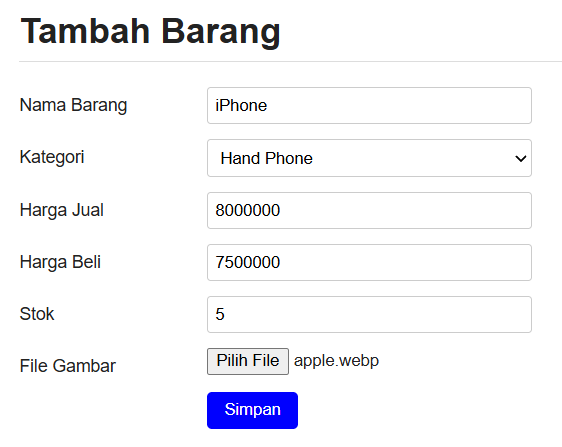

*Gambar 9. Form Tambah Barang (contoh: iPhone, kategori Hand Phone)*

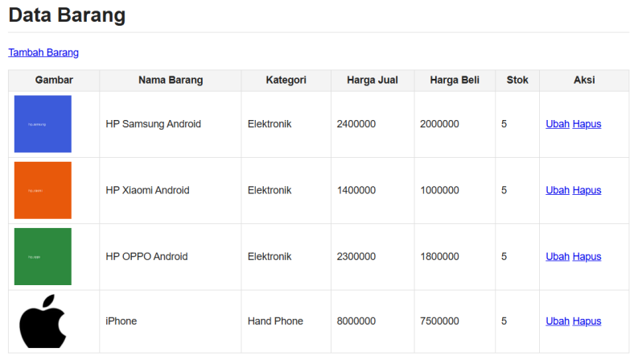

*Gambar 10. Data iPhone muncul di halaman index setelah disimpan*

### 4.10 Mengubah Data (Update): `ubah.php`

```php
<?php
error_reporting(E_ALL);
include_once 'koneksi.php';

if (isset($_POST['submit']))
{
    $id         = (int) $_POST['id'];
    $nama       = $_POST['nama'];
    $kategori   = $_POST['kategori'];
    $harga_jual = (int) $_POST['harga_jual'];
    $harga_beli = (int) $_POST['harga_beli'];
    $stok       = (int) $_POST['stok'];
    $file_gambar = $_FILES['file_gambar'];
    $gambar = null;

    if ($file_gambar['error'] == 0)
    {
        $filename = str_replace(' ', '_', basename($file_gambar['name']));
        $destination = dirname(__FILE__) . '/gambar/' . $filename;
        if (move_uploaded_file($file_gambar['tmp_name'], $destination))
        {
            $gambar = $filename;
        }
    }

    if (!empty($gambar))
    {
        $stmt = mysqli_prepare($conn,
            'UPDATE data_barang SET nama=?, kategori=?, harga_jual=?, harga_beli=?, stok=?, gambar=? WHERE id_barang=?');
        mysqli_stmt_bind_param($stmt, 'ssiiisi', $nama, $kategori, $harga_jual, $harga_beli, $stok, $gambar, $id);
    }
    else
    {
        $stmt = mysqli_prepare($conn,
            'UPDATE data_barang SET nama=?, kategori=?, harga_jual=?, harga_beli=?, stok=? WHERE id_barang=?');
        mysqli_stmt_bind_param($stmt, 'ssiiii', $nama, $kategori, $harga_jual, $harga_beli, $stok, $id);
    }
    mysqli_stmt_execute($stmt);
    header('location: index.php');
    exit;
}

$id = isset($_GET['id']) ? (int) $_GET['id'] : 0;
$stmt = mysqli_prepare($conn, 'SELECT * FROM data_barang WHERE id_barang = ?');
mysqli_stmt_bind_param($stmt, 'i', $id);
mysqli_stmt_execute($stmt);
$result = mysqli_stmt_get_result($stmt);
$data = mysqli_fetch_array($result);
if (!$data) die('Error: Data tidak tersedia');

function is_select($var, $val) {
    if ($var == $val) return 'selected="selected"';
    return false;
}
?>
<!DOCTYPE html>
<html lang="en">
<head>
    <meta charset="UTF-8">
    <link href="style.css" rel="stylesheet" type="text/css" />
    <title>Ubah Barang</title>
</head>
<body>
<div class="container">
    <h1>Ubah Barang</h1>
    <div class="main">
        <form method="post" action="ubah.php" enctype="multipart/form-data">
            <div class="input">
                <label>Nama Barang</label>
                <input type="text" name="nama" value="<?php echo htmlspecialchars($data['nama']);?>" />
            </div>
            <div class="input">
                <label>Kategori</label>
                <select name="kategori">
                    <option <?php echo is_select('Komputer', $data['kategori']);?> value="Komputer">Komputer</option>
                    <option <?php echo is_select('Elektronik', $data['kategori']);?> value="Elektronik">Elektronik</option>
                    <option <?php echo is_select('Hand Phone', $data['kategori']);?> value="Hand Phone">Hand Phone</option>
                </select>
            </div>
            <div class="input">
                <label>Harga Jual</label>
                <input type="text" name="harga_jual" value="<?php echo $data['harga_jual'];?>" />
            </div>
            <div class="input">
                <label>Harga Beli</label>
                <input type="text" name="harga_beli" value="<?php echo $data['harga_beli'];?>" />
            </div>
            <div class="input">
                <label>Stok</label>
                <input type="text" name="stok" value="<?php echo $data['stok'];?>" />
            </div>
            <div class="input">
                <label>File Gambar</label>
                <input type="file" name="file_gambar" />
            </div>
            <div class="submit">
                <input type="hidden" name="id" value="<?php echo $data['id_barang'];?>" />
                <input type="submit" name="submit" value="Simpan" />
            </div>
        </form>
    </div>
</div>
</body>
</html>
```

**Penjelasan:** Halaman ini menerima id dari URL (`$_GET["id"]`), mengambil data lama dengan `SELECT ... WHERE id_barang`, lalu mengisinya ke form (atribut `value`). Fungsi `is_select()` menandai option kategori yang sesuai dengan data lama (`selected`). Id disimpan di input `hidden` agar ikut terkirim saat form disubmit. Saat disubmit, perintah `UPDATE` dijalankan; kolom gambar hanya diubah jika ada file baru yang diupload.

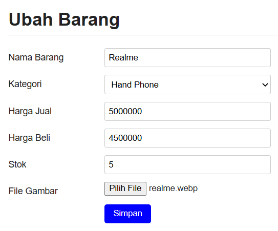

*Gambar 11. Form Ubah Barang (contoh: data diubah menjadi Realme)*

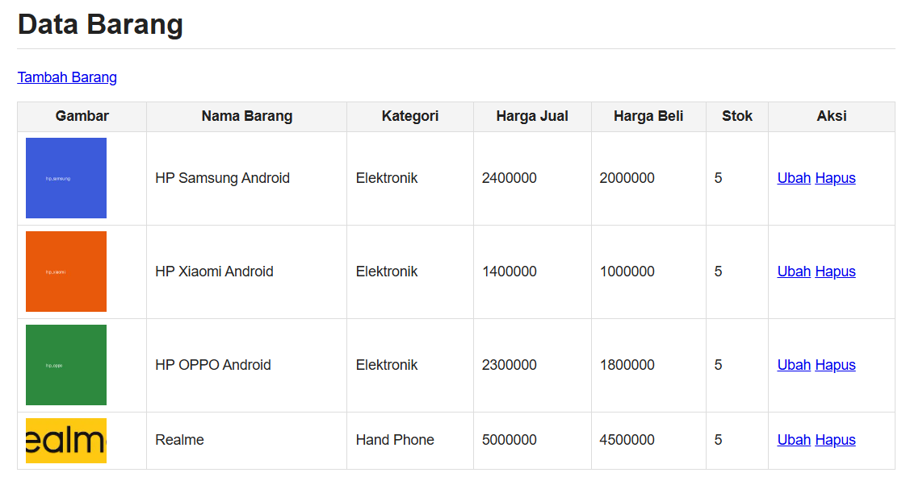

*Gambar 12. Data berubah di halaman index setelah disimpan*

### 4.11 Menghapus Data (Delete): `hapus.php`

```php
<?php
include_once 'koneksi.php';

$id = isset($_GET['id']) ? (int) $_GET['id'] : 0;
$stmt = mysqli_prepare($conn, 'DELETE FROM data_barang WHERE id_barang = ?');
mysqli_stmt_bind_param($stmt, 'i', $id);
mysqli_stmt_execute($stmt);
header('location: index.php');
?>
```

**Penjelasan:** File ini mengambil id dari URL, menjalankan `DELETE FROM data_barang WHERE id_barang`, lalu kembali ke `index.php`. Pada `index.php` ditambahkan konfirmasi JavaScript (`confirm`) agar data tidak terhapus tanpa sengaja.

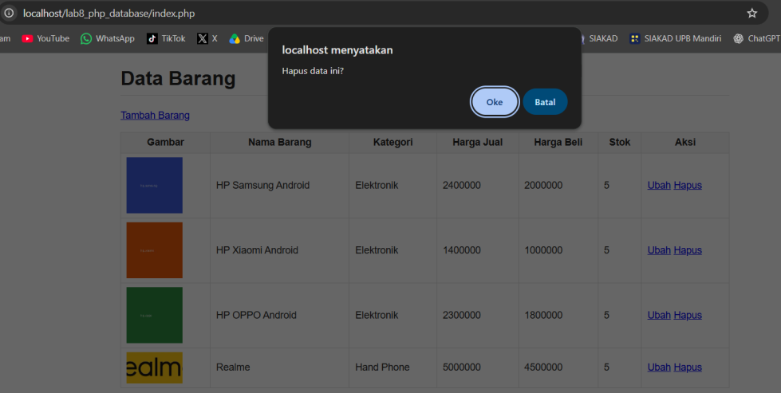

*Gambar 13. Dialog konfirmasi "Hapus data ini?" saat link Hapus diklik*

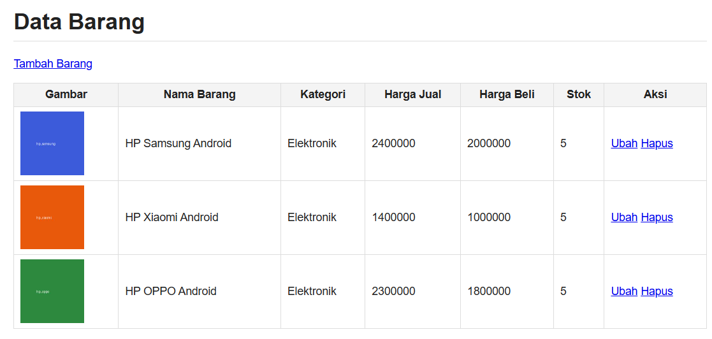

*Gambar 14. Data Realme sudah terhapus dari halaman index*

### 4.12 File Tampilan (`style.css`)
Modul memanggil `style.css` tetapi tidak memberikan isinya. File ini dibuat sendiri untuk merapikan tabel dan form.

```css
* { margin: 0; padding: 0; box-sizing: border-box; }
body { font-family: Arial, Helvetica, sans-serif; font-size: 14px; color: #222; }
.container { width: 900px; max-width: 100%; margin: 20px auto; padding: 0 15px; }
h1 { padding-bottom: 8px; border-bottom: 1px solid #ddd; margin-bottom: 20px; }
.main p { margin-bottom: 15px; }
a { color: #0000ee; }
table { border-collapse: collapse; width: 100%; }
th, td { border: 1px solid #ddd; padding: 6px 8px; text-align: left; }
th { text-align: center; background: #f4f4f4; }
td img { width: 80px; height: auto; display: block; }
.input { display: flex; margin-bottom: 12px; }
.input label { width: 150px; padding-top: 6px; }
.input input[type=text], .input select { padding: 6px; border: 1px solid #ccc; border-radius: 3px; width: 260px; }
.submit { margin-left: 150px; }
.submit input { background: #0000ff; color: #fff; border: 0; padding: 7px 14px; border-radius: 4px; cursor: pointer; }
```

## 5. Perbaikan terhadap Kode Modul
Saat dikerjakan, ada beberapa kekurangan pada kode di modul yang diperbaiki agar program berjalan benar dan aman:

| File | Masalah pada modul | Perbaikan |
|---|---|---|
| `index.php` | Kolom data tidak sesuai header (harga beli tampil di bawah Harga Jual), kolom Aksi hanya menampilkan id, tidak ada link Tambah/Ubah/Hapus, dan path gambar bisa dobel (`gambar/gambar/...`). | Urutan kolom disesuaikan, link Tambah/Ubah/Hapus ditambahkan, path memakai `basename()` dan hanya nama file yang disimpan di database. |
| `ubah.php` | `enctype` tertulis `multipart/formdata` (typo) sehingga upload gambar gagal; `is_select()` selalu membandingkan dengan "Komputer". | Diubah menjadi `multipart/form-data`; pembanding disesuaikan per kategori. |
| `tambah.php`, `ubah.php`, `hapus.php` | Query menyisipkan variabel langsung ke SQL sehingga rentan SQL Injection. | Memakai prepared statement (`mysqli_prepare` + `bind_param`) dan casting `(int)` untuk angka. |
| `index.php` | Output tidak di-escape. | Memakai `htmlspecialchars()` untuk mencegah XSS. |

## 6. Menjalankan Program
1. Pastikan Apache dan MySQL berjalan di XAMPP.
2. Import `database.sql` lewat phpMyAdmin (tab **Import**) atau jalankan isinya pada tab **SQL**.
3. Salin folder `lab8_php_database` ke `htdocs`.
4. Buka `http://localhost/lab8_php_database/` dan coba semua fitur: tambah, ubah, hapus.

## 7. Kesimpulan
Dengan praktikum ini, saya memahami cara membuat database dan tabel di MySQL, menghubungkan PHP ke database dengan `mysqli`, serta membuat aplikasi CRUD sederhana yang terdiri dari halaman tampil (Read), tambah (Create), ubah (Update), dan hapus (Delete). Penggunaan prepared statement juga penting agar aplikasi aman dari SQL Injection.
